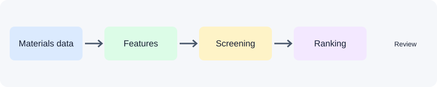

# DuctGPT-Mini 🧪⚛️

> An open research prototype for reproducible screening of tungsten-based alloy candidates.


## What it does

DuctGPT-Mini provides an inspectable workflow to fetch tungsten-containing elasticity records, calculate the Pugh ratio (G/K), screen candidates using explicit thresholds, and experiment with a baseline Random Forest model. Its natural-language agent uses OpenAI-compatible function calling to translate requests into deterministic local screening operations.

This is an independent community prototype inspired by natural-language materials-discovery concepts. It is not affiliated with or endorsed by Ames National Laboratory and does not reproduce a proprietary system.

## Workflow



## Quick start

```bash
git clone https://github.com/Isyakuahmad/ductgpt-mini.git
cd ductgpt-mini
python -m venv .venv
# Activate the environment, then:
pip install -r requirements.txt
pytest -q
```

## Natural-language alloy screening

Copy `.env.example` to `.env` and configure one LLM provider.

**OpenAI:**

```env
OPENAI_API_KEY=your_api_key
LLM_MODEL=gpt-4o-mini
```

**Ollama (OpenAI-compatible API):**

```env
OLLAMA_BASE_URL=http://localhost:11434/v1
LLM_MODEL=llama3.1
```

Ensure the selected Ollama model is available locally (for example, run `ollama pull llama3.1`). Then ask a question in ordinary language:

```bash
python src/llm_agent.py "Find ductile W alloys with Ta"
```

The agent sends the request and the `screen_alloys` function schema to the model. If the model requests screening, the application validates its JSON arguments, runs the local screening function, returns the records to the model for interpretation, and prints the natural-language answer followed by the result DataFrame.

The tool accepts `max_pugh`, `min_K` (minimum bulk modulus in GPa), and `elements` (all listed symbols must occur in the formula). To use another CSV, set `ALLOY_DATA_PATH` to its path. Without an LLM provider configured, the agent reports a configuration error; the deterministic screening functions and tests can still be used directly.

## Materials Project data (optional)

Copy `.env.example` to `.env`, add your Materials Project API key, then run:

```bash
python -m src.fetch_data
```

Downloaded records are saved under `data/`; generated datasets are ignored by Git by default.

## Exploratory baseline

```bash
python -m src.train_model --data data/sample_W_alloys.csv
```

The included fixture is synthetic and deliberately small. A model trained on it is only a software demonstration, not a scientifically useful predictor. Use a sufficiently large, curated dataset and appropriate validation before drawing conclusions.

Optional interface: `streamlit run app/streamlit_app.py`.

## Scientific caveats

- Pugh ratio is an empirical heuristic, not a direct measurement or guarantee of ductility.
- Materials Project values are computational data, not necessarily experimental measurements.
- The sample CSV contains illustrative software-test values, not real alloy results.
- Predictions and rankings require independent verification, literature review, and, where appropriate, DFT and experimental validation.

See [architecture](docs/architecture.md), [data notes](data/README.md), and [MIT License](LICENSE).
